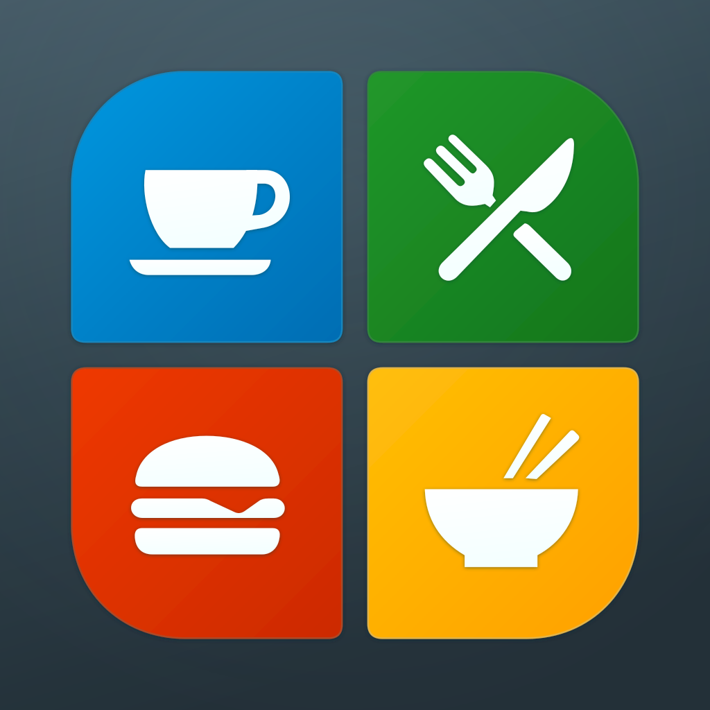

# What the Food

<p align="center">
  <a href="https://michaelsinz.github.io/WhatTheFood/"></a>
</p>

WTF is a common phrase when we realize that something isn't working as it should (or could).

Campus food services have separate websites, vendors move around, and menus change daily.  The lack of a unified search was a "What the Food?" moment for us.

What the Food combines a Rust menu scraper with a standalone, responsive web page.  Search across locations, vendors, categories, dishes, descriptions, and base prices, then open the provider's ordering website.  There is no cart, checkout, or payment handling here.

The page searches a snapshot produced by the scraper; it never contacts the menu APIs.  To update the menus, run the scraper again, replace `menus.js`, and reload the page.

Search requires every word to match.  Use double quotes for a phrase within one field, such as `"Food hall 6" chicken`.  Matching ignores case and accents; results keep your chosen sort order.

You can choose which locations to include in searches and results directly on the page.  Your choices are stored locally in your browser and remembered across page loads in the same browser.

Searches and location preferences are not sent to a server.  In fact, the page works directly from your local filesystem without an HTTP server.

Dates use the America/Los_Angeles time zone.  Old menus are labeled as old, not presented as today's offerings.  Only location choices are saved in local storage, with session storage as a fallback.  Menus stay in `menus.js`; search and sorting stay in memory.

## Build and deploy

On Linux or macOS, install a current Rust toolchain with Cargo (supporting edition 2024), a C compiler/linker, `make`, and `awk`.  Normal builds do **not** need Node.js, npm, or Playwright.  Fetching menus needs an internet connection.

```sh
make help
make web
```

`make web` runs the Rust unit/CLI tests, builds the release scraper, embeds the SVG into the HTML, and fetches fresh menu data.  Copy the **contents of `web/`** to your static website:

```text
index.html
menus.js
```

There are no tests, documentation, build tools, or dependencies in that directory.  The icon, CSS, and application JavaScript are embedded in `index.html`.  The full icon appears centered while menus load and disappears when the initial results or an error are ready.  You can also open `web/index.html` directly from disk without a server.

Configure your web server to revalidate `menus.js` or give it a short cache lifetime so daily updates are visible.  Generated website files are ignored by git; a fresh checkout needs `make web` before deployment.

## Scraper

```sh
make food-finder
rust/target/release/food-finder --urls locations.json --output web/menus.js

# Without --output, only the generated data script goes to stdout.
rust/target/release/food-finder --urls locations.json > web/menus.js

# Select particular locations, or use another runtime URL directory.
rust/target/release/food-finder --urls locations.json --location "Food Hall 6" --output web/menus.js
make web URLS=locations.json CONCURRENCY=4
```

`locations.json` is an array of `{"name": "...", "url": "https://....buy-ondemand.com/"}` objects.  A null URL preserves an unlinked directory entry.  Edit this file to add or remove locations without recompiling.  The scraper requires `--urls`; the legacy `--catalog` spelling is also accepted.

Selected locations must have nonblank names and unique IDs: the parsed URL hostname, or the name when no hostname is available.  Duplicate IDs (including a hostname matching an unlinked entry's name) and blank names fail before any fetching or output replacement.

Every invocation fetches fresh menus, with independent sessions per location and no request/menu cache.  `menus.js` uses readable multi-line formatting with two-space indentation, both for named-file output and stdout.  All progress, notices, warnings, and errors go to stderr.  Credentials remain in memory and are not written to the output.

`--output` atomically replaces the named file.  If a location fails, the scraper still produces a clearly marked partial snapshot containing successful locations; the page displays the failures.  If at most half of the selected linked locations fail, the scraper warns on stderr and exits successfully.  If more than half fail (including when all fail), it reports an error and exits nonzero after writing the snapshot.  Unlinked entries are excluded from this threshold; successfully fetched closed or empty menus count as successes.  Fatal input or write errors still exit nonzero.  If your deployment must reject all partial snapshots, check the snapshot's `complete` field before publishing; exit status alone does not indicate completeness.  Prefer `--output` over shell redirection when replacing deployed data.

The executable needs no separately installed Rust runtime, OpenSSL library, Node.js, or browser.  Rustls provides HTTPS with bundled public certificate roots, and timezone data is embedded.  The URL catalog remains a runtime input, not a compiled dependency.  Release builds use link-time optimization, one code-generation unit, and stripped symbols.

The default build targets the machine running `make`.  For a fully static Linux executable, install the appropriate Rust musl target and C/linker toolchain, then build for the destination architecture:

```sh
# 32-bit x86 Linux:
make food-finder TARGET=i686-unknown-linux-musl
# 64-bit x86 Linux:
make food-finder TARGET=x86_64-unknown-linux-musl
```

The binary is written to `rust/target/<target>/release/food-finder`.  Host-side unit/CLI tests still run before cross-compilation.  Cross-target builds require a suitable cross compiler; installing the Rust target alone is not sufficient.  Native macOS executables use standard Apple system libraries rather than being fully static.  Verify cross-built binaries on their destination system.

## Development and optional browser tests

Edit `site/index.html`, not the generated `web/index.html`.  `WhatTheFood.svg` is the icon source used by both this README and the generated page.

| Target | Purpose |
| --- | --- |
| `make html` | Build just the HTML; no scraping, Rust build, or Node.js |
| `make food-finder` | Run Rust tests and build the release scraper |
| `make menus` | Run Rust tests, build the scraper, and fetch fresh menus |
| `make test-rust` | Run offline Rust unit and CLI tests |
| `make check` | Run Rust tests, formatting checks, and Clippy |
| `make setup-test` | Install optional Playwright tooling and Chromium/WebKit engines |
| `make test-web` | Build the HTML and run browser tests |
| `make test` | Run both Rust and browser tests |
| `make clean` | Remove Rust build products and generated HTML; retain menu data |

For browser testing only, install Node.js 22+ and npm, then:

```sh
make setup-test
make test-web
```

On Linux, Playwright may also require system libraries; its `node node_modules/playwright/cli.js install-deps chromium webkit` command installs the supported dependencies and may need administrator privileges.  Browser engines are stored under `.tmp/playwright`.  This setup is never invoked by a normal build.

Browser tests run headless Chromium and WebKit against synthetic menus, including direct-file loading, static hosting, phrase search, sorting, location preferences, and the loading screen.  They emulate phone layouts, not an actual phone's software keyboard.

See [project.md](project.md) for implementation details and protocol limitations.

## The WTF Name

I initially thought of using "Start Menu" as the name of this app, but that was a bit too close for comfort.  I also considered "Where's the Food," but that was not as funny as "What the Food."  Both work with WTF.

This all came about because of the really, really horrible dining websites.  Each building had its own website, and some vendors also had their own sites for that building.  Each vendor would only show its offerings while they were available, and there was no way to search across vendors, let alone across the different sites, to find a specific dish, style of food, or vendor.  Since some vendors move from location to location every day, even finding a specific vendor is not so easy.  For example, after eating, we once found out that a favorite of ours had been in the next building that day.

With all of these annoyances in mind, some time to plan, and help from GitHub Copilot, I built this little scraper and web page and listed the known sites in the [locations.json](locations.json) file.  I give Copilot [project.md](project.md) to define the project, and I have kept it updated as the project has evolved.

Where this goes from here is unknown, but it is already far more useful than we had expected.